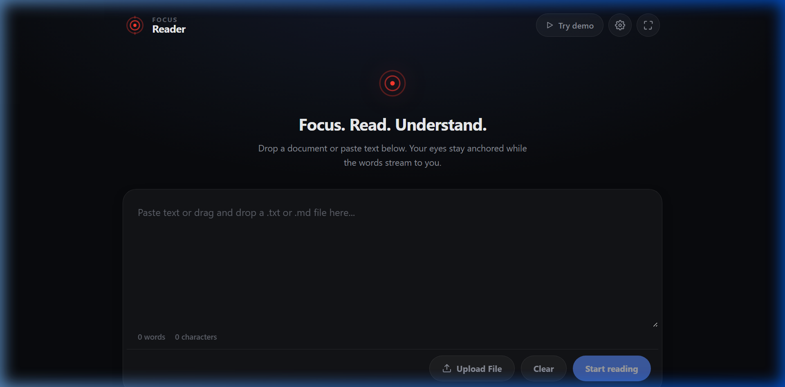
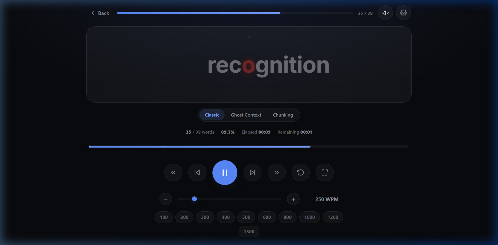
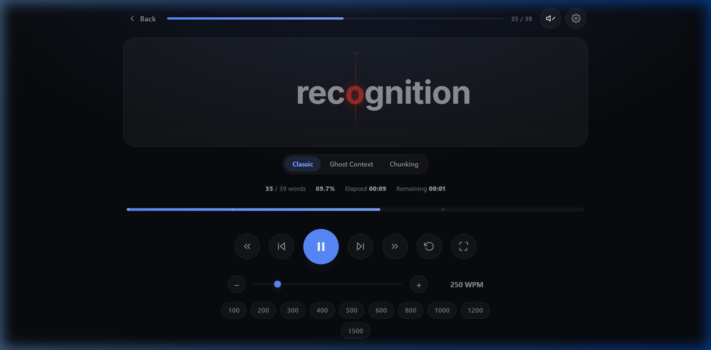
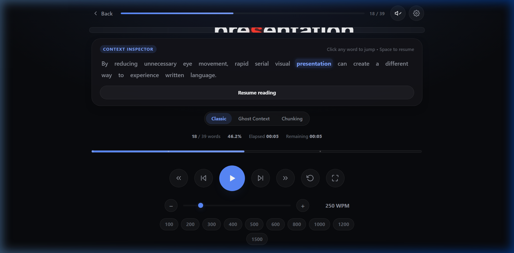
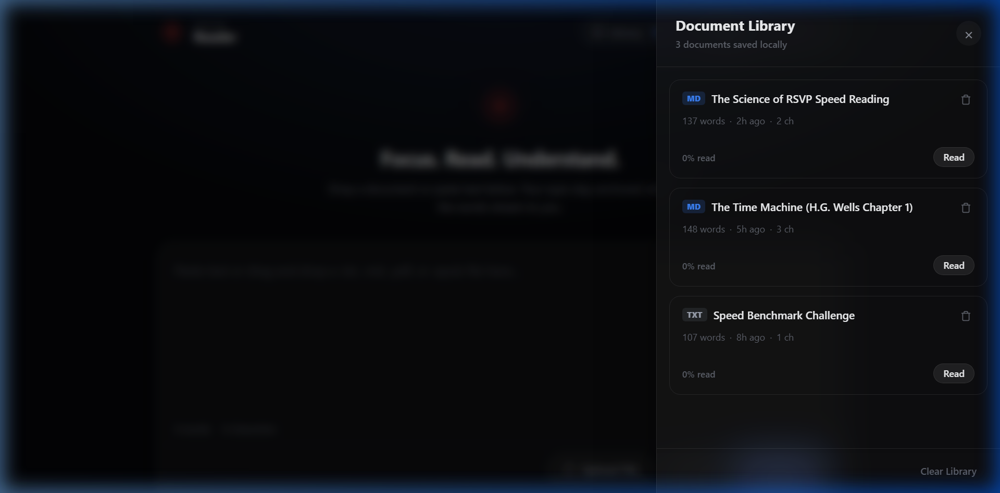

# Focus Reader Pro

<p align="center">
  <strong>Modern, accessible RSVP speed reader with dynamic ORP alignment, Bionic reading, peripheral context, and zero-server local storage.</strong>
</p>

<p align="center">
  <a href="https://github.com/saptarshidas578/speed_reader/actions/workflows/ci.yml"></a>
  <a href="LICENSE"></a>
  
  
  
  <a href="PRIVACY.md"></a>
</p>

---

## 📖 The Science of RSVP & Optimal Recognition Points

In traditional reading, human eyes spend **up to 80% of total time making physical eye jumps (saccades)** rather than processing meaning. 

**Rapid Serial Visual Presentation (RSVP)** eliminates physical saccadic latency by streaming words sequentially at a single focal point. **Focus Reader Pro** elevates RSVP by dynamically centering words at their **Optimal Recognition Point (ORP)**—the exact fixation anchor (typically 25%–35% into a word) where the brain identifies meaning up to 4× faster.

---

## 🖼️ Application Showcase

### 1. Ingestion & Visual Setup
> Paste custom text, select target WPM speed, choose progressive ramp-ups, or drag-and-drop books.


### 2. High-Precision RSVP Reader View
> Sub-millisecond drift-free word streaming with dynamic ORP fixation in crimson and center guides.


### 3. Interactive Timeline Scrubber & Velocity Controls
> Scrub to any point in the stream with live percentage, remaining words, and time feedback.


### 4. Ambient Pause Context & Sentence Recovery
> Pausing automatically surfaces surrounding sentence context and enables one-key sentence rewind (`[` / `]`).


### 5. Persistent IndexedDB Document Library
> Full client-side library persisting books, chapters, and automatic word bookmarks across sessions.


---

## ⚡ Key Features

### 🚀 Core Timing Engine
- **Drift-Free `requestAnimationFrame` Clock:** Prevents browser timing throttling and guarantees steady cadence across fluctuating frame rates.
- **Dynamic ORP Character Centering:** Measures character widths in an off-screen HTML5 canvas to lock the fixation letter in place.
- **Smart Punctuation Pauses:** Weighted multipliers give cognitive breathing room at sentence ends (`.`, `!`, `?` at 2.2×), commas/clauses (1.5×), and paragraphs (2.8×).
- **Progressive Speed Acceleration:** Smoothly accelerates from a gentle starting pace up to your target WPM.

### 🎨 Visual Ergonomics & Modes
- **Three Visualization Modes:**
  - **Classic ORP Mode:** Single-word focal stream with red fixation anchor.
  - **Ghost Context Mode:** Dimmed previous and upcoming words flanking the center word.
  - **Chunking Mode:** Multi-word rhythmic bursts (1, 2, or 3 words) for rapid phrase scanning.
- **Bionic Reading:** Emphasizes initial word characters in bold for rapid cognitive guidance.
- **Typography Engine:** Select between Inter Sans, JetBrains Mono, OpenDyslexic, or System Default with 4 font scale presets.
- **Theme Engine:** Minimalist Light Mode and deep OLED Dark Mode with customizable focal colors.

### 🎧 Sound & Accessibility
- **Synthesized Web Audio Metronome:** Sub-millisecond auditory micro-clicks synced with word flashes without loading external audio files.
- **Sentence Rewind (`[` / `]`):** Instant one-key sentence recovery when comprehension slips.
- **Interactive Scrubber:** Jump to any percentage of the document with remaining time estimates.
- **Keyboard Cheatsheet (`?`):** Comprehensive shortcut reference covering all navigation and pacing hotkeys.

### 📚 Ingestion & 100% Private Local Storage
- **Format Ingestion:** Drag and drop `.txt`, `.md`, `.epub`, or `.pdf` files.
- **Table of Contents:** Automatic heading detection and EPUB/PDF chapter navigation.
- **Zero-Server Guarantee:** 100% on-device processing. No data is ever transmitted to a server.
- **IndexedDB Library:** Persistent document storage with automatic word bookmarks and lifetime velocity analytics.

---

## ⌨️ Keyboard Shortcuts Reference

Press <kbd>?</kbd> anywhere in the app to display the full keyboard cheatsheet:

| Shortcut | Description |
|---|---|
| <kbd>Space</kbd> | Play / Pause reading stream |
| <kbd>←</kbd> / <kbd>→</kbd> | Step 1 word backward / forward |
| <kbd>[</kbd> / <kbd>]</kbd> | Rewind / Skip 1 complete sentence |
| <kbd>↑</kbd> / <kbd>↓</kbd> | Adjust speed by ±25 WPM |
| <kbd>1</kbd> | Classic ORP Focal Mode |
| <kbd>2</kbd> | Ghost Context Mode |
| <kbd>3</kbd> | Multi-Word Chunking Mode |
| <kbd>R</kbd> | Restart stream from beginning |
| <kbd>F</kbd> | Toggle vertical focal guide lines |
| <kbd>M</kbd> | Toggle auditory metronome clicks |
| <kbd>C</kbd> | Open Table of Contents / Chapters drawer |
| <kbd>?</kbd> | Open Keyboard Shortcuts cheatsheet |
| <kbd>Esc</kbd> | Close active drawer or exit to setup |

---

## 🛠️ Tech Stack

- **Framework:** [React 19](https://react.dev/)
- **Build Tool:** [Vite 8](https://vitejs.dev/)
- **Language:** [TypeScript](https://www.typescriptlang.org/) (Strict mode)
- **Styling:** Bespoke Vanilla CSS Design System with custom property design tokens (Zero utility overhead)
- **Document Extractors:** [PDF.js](https://mozilla.github.io/pdf.js/) (`pdfjs-dist`) & [JSZip](https://stuk.github.io/jszip/) (Lazy-loaded via dynamic ESM chunks)
- **Audio:** Web Audio API (Synthesized oscillators & gain envelopes)
- **Persistence:** HTML5 IndexedDB API & `localStorage`
- **Testing:** [Vitest](https://vitest.dev/) (32 unit tests across 8 test suites)

---

## 🚀 Quick Start for Beginners

### 1. Prerequisites
Ensure you have [Node.js](https://nodejs.org/) (v18 or higher) installed on your system.

### 2. Clone & Install
```bash
# Clone the repository
git clone https://github.com/saptarshidas578/speed_reader.git

# Enter project directory
cd speed_reader

# Install dependencies
npm install
```

### 3. Run Development Server
```bash
npm run dev
```
Open [http://localhost:5173/](http://localhost:5173/) in your web browser.

### 4. Build for Production
```bash
# Run unit tests
npm test -- --run

# Compile TypeScript and bundle production build
npm run build

# Preview production build locally
npm run preview
```

---

## 🔍 Known Limitations

- **DRM-Protected Books:** Focus Reader Pro runs entirely in the browser and deliberately does not decrypt proprietary DRM formats (e.g., Kindle `.azw` or Adobe Adept `.epub`). Use DRM-free books.
- **Scanned Image PDFs:** PDFs consisting entirely of scanned images without embedded text layers require OCR preprocessing before ingestion.
- **Autoplay Policies:** In accordance with browser security policies, the auditory metronome requires at least one user interaction (`Space` or click) before sound can play.

---

## 🗺️ Roadmap

- [ ] Opt-in encrypted cloud sync across devices
- [ ] Progressive Web App (PWA) offline installation manifest & service worker
- [ ] Text-to-Speech (TTS) simultaneous read-along voice synthesis
- [ ] User-customizable CSS color theme builder

---

## 👤 Author

Developed by **Saptarshi Das**:
- 🌐 **GitHub:** [@saptarshidas578](https://github.com/saptarshidas578)
- 💼 **LinkedIn:** [Saptarshi Das on LinkedIn](https://www.linkedin.com/in/saptarshi-das-3255673a1/)

---

## 📄 License & Acknowledgments

- This project is licensed under the **[MIT License](LICENSE)** © 2026 Saptarshi Das.
- Third-party open source licenses and attributions are documented in **[THIRD_PARTY_NOTICES.md](THIRD_PARTY_NOTICES.md)**.
- Typeface acknowledgments: *Inter* (Rasmus Andersson), *JetBrains Mono* (JetBrains), *OpenDyslexic* (Abbie Gonzalez).
