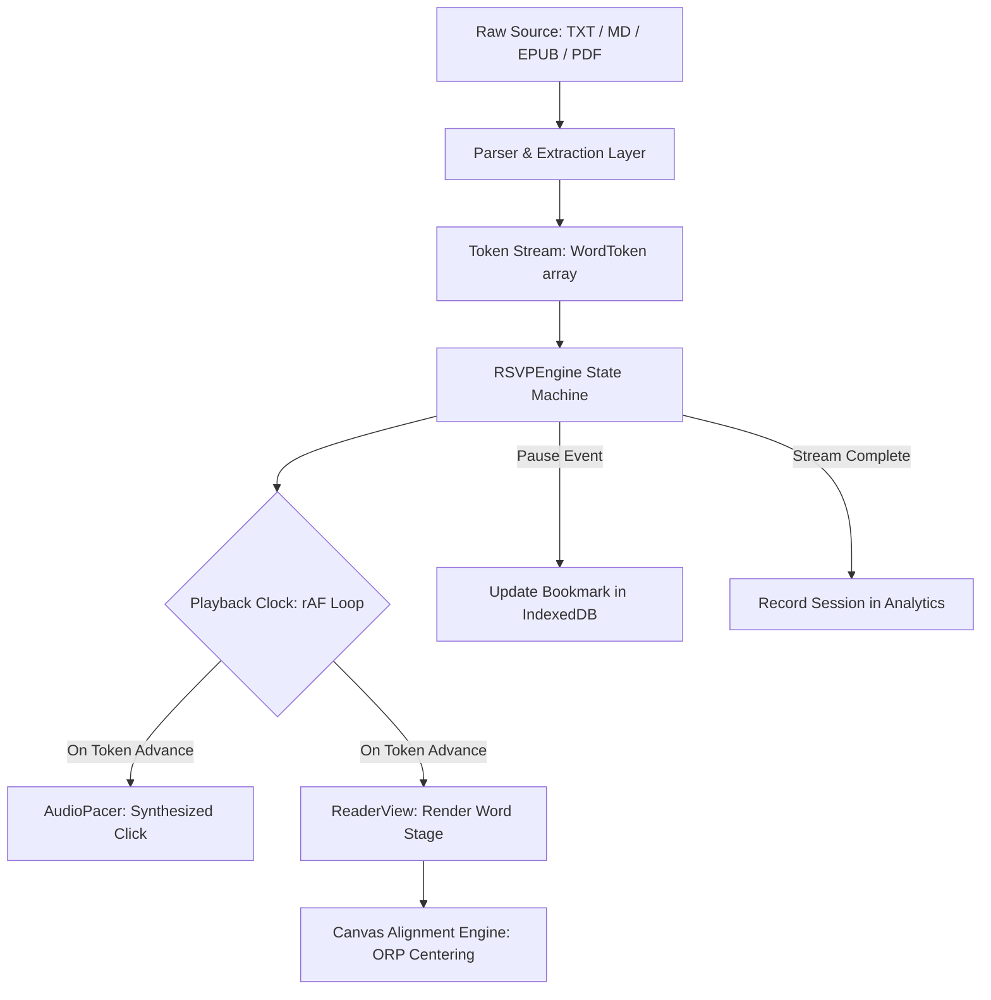

# Focus Reader Pro — System Architecture

This document provides a comprehensive architectural breakdown of **Focus Reader Pro**, a 100% client-side Rapid Serial Visual Presentation (RSVP) speed reading application engineered for sub-millisecond precision, cognitive ergonomics, and complete local privacy.

---

## 1. Directory & File Map

```
speed_reader/
├── index.html                   # Single-page HTML shell with Google Fonts & root mount
├── vite.config.ts               # Vite bundler configuration with React plugin
├── tsconfig.json                # TypeScript project references root
├── tsconfig.app.json            # Application TypeScript configuration (strict mode)
├── tsconfig.node.json           # Node tooling TypeScript configuration
├── package.json                 # Project dependencies, scripts, and repository metadata
├── SPEC.md                      # Canonical product specification
├── docs/                        # Architecture, user guides, troubleshooting, decisions
│   ├── ARCHITECTURE.md          # This architectural blueprint
│   ├── USER_GUIDE.md            # Comprehensive user manual
│   ├── DEVELOPMENT.md           # Local setup and engineering guidelines
│   ├── TROUBLESHOOTING.md       # Diagnostic fixes and edge-case handling
│   ├── DECISIONS.md             # Architectural Decision Records (ADRs)
│   ├── images/                  # Verified UI screenshots
│   └── history/                 # Development history & tracer-bullet tickets
└── src/
    ├── main.tsx                 # React DOM root entry point
    ├── App.tsx                  # Top-level view routing, modal orchestration & state sync
    ├── index.css                # Bespoke Vanilla CSS design system & custom property tokens
    ├── types/
    │   └── reader.ts            # Core domain contracts (WordToken, ReaderSettings, Modes)
    ├── engine/
    │   ├── rsvpEngine.ts        # Drift-free requestAnimationFrame playback clock
    │   ├── textParser.ts        # Text tokenizer & ORP calculation engine
    │   ├── markdownParser.ts    # Markdown cleaner & chapter heading extractor
    │   ├── epubExtractor.ts     # Asynchronous client-side EPUB parser (JSZip)
    │   ├── pdfExtractor.ts      # Asynchronous client-side PDF parser (PDF.js)
    │   ├── storage.ts           # IndexedDB client library & bookmark repository
    │   ├── analytics.ts         # Session velocity tracking & rolling metrics
    │   ├── audioPacer.ts        # Web Audio API synthesized micro-click metronome
    │   └── bionicFormatter.ts   # Saccadic fixation bolding engine
    └── components/
        ├── Header.tsx           # Brand masthead, library trigger, demo, settings & analytics
        ├── SetupView.tsx        # Ingestion hero, paste area, drag-and-drop, and WPM dial
        ├── ReaderView.tsx       # RSVP viewport, focal guide, scrubber, transport controls
        ├── CompleteView.tsx     # Session celebration card, stats grid, and action triggers
        ├── SettingsDrawer.tsx   # Visual themes, audio controls, progressive ramps drawer
        ├── LibraryDrawer.tsx    # Slide-out persistent IndexedDB document book shelf
        ├── ChapterDrawer.tsx    # Table-of-contents chapter navigation drawer
        ├── AnalyticsModal.tsx   # Hero metrics grid and session velocity timeline modal
        ├── KeyboardCheatsheetModal.tsx # Interactive keyboard shortcuts reference card
        ├── TimelineScrubber.tsx # Percentage scrubber slider and progress feedback
        ├── PauseContextCard.tsx # Ambient sentence context card on stream pause
        ├── CountdownOverlay.tsx # 3-2-1 animated pulse countdown overlay
        └── Toast.tsx            # Transient toast notification banner system
```

---

## 2. Drift-Free Playback Clock (`requestAnimationFrame`)

### The Flaw of Traditional Timers
Standard web timers (`setInterval` or `setTimeout`) are notoriously inaccurate for Rapid Serial Visual Presentation. Browsers throttle timeouts under CPU load, clamp callbacks during tab switches, and suffer from cumulative execution jitter that causes erratic word durations.

### The Drift-Free rAF Solution
`RSVPEngine` utilizes a continuous `requestAnimationFrame` loop combined with absolute high-precision timestamps (`performance.now()`):

```
Target Frame Time: Target Word Duration = Base Interval × Smart Multiplier
Accumulated Time:  accumulatedMs += (currentTimestamp - lastTimestamp)
```

1. **Cycle Tracking:** At each animation frame, the engine calculates the precise delta since the previous frame.
2. **Deterministic Threshold:** Rather than firing a delayed callback, the engine advances to the next token only when `accumulatedMs >= activeWordDuration`.
3. **Zero Cumulative Drift:** Any frame overshoots are carried forward into the subsequent interval rather than discarded, guaranteeing that over a 10,000-word reading stream, the average word duration matches the calculated mathematical ideal down to the microsecond.

---

## 3. Optimal Recognition Point (ORP) & Canvas Alignment

### The Cognitive Science
During regular reading, human eyes spend ~80% of total reading time making physical saccadic jumps. In RSVP, saccades are eliminated by presenting words at a single fixation point.

However, centering words by their geometric midpoint causes ocular strain because the human brain identifies words most efficiently when fixating at their **Optimal Recognition Point (ORP)**—roughly 25% to 35% into the word length.

### Mathematical Model
```typescript
function calculateOrpIndex(length: number): number {
  if (length <= 1) return 0;
  if (length <= 3) return 1;
  return Math.min(length - 1, Math.floor((length - 1) * 0.35));
}
```

### Canvas-Measured Horizontal Centering
Because characters have variable physical widths in proportional typefaces (e.g. `W` vs `i`), CSS character-count offsets will drift horizontally.

Focus Reader Pro solves this by dynamically measuring pixel widths via an off-screen HTML5 `CanvasRenderingContext2D`:

```typescript
const beforeWidth = ctx.measureText(beforeText).width;
const orpWidth    = ctx.measureText(orpChar).width;
const viewportMid = viewportWidth / 2;

// Exact pixel left offset to place the ORP character at the viewport center line
const desiredLeft = viewportMid - beforeWidth - (orpWidth / 2);
wordStage.style.left = `${desiredLeft}px`;
```

---

## 4. End-to-End Data Pipeline



1. **Ingestion & Extraction:**
   - Raw text is normalized.
   - Markdown headers (`#`, `##`) are extracted into `ChapterMarker` structures with word index offsets.
   - EPUB files are unpacked using `JSZip` to extract XML spine documents, strip HTML tags, and build TOCs.
   - PDF files are rendered using `pdfjs-dist` inside an isolated Web Worker, extracting text page-by-page.
2. **Tokenization:**
   - Every word is transformed into a `WordToken` preserving raw text, clean display string, sentence-ending markers, pause multipliers, and precomputed ORP indices.
3. **Execution & Event Dispatch:**
   - `RSVPEngine` controls index advancement, progressive ramp-up, sentence skipping, and emits status/token events to React components.

---

## 5. Web Audio Synthesizer Architecture

Rather than loading bulky MP3/WAV files that introduce network latency and decoding lag, `AudioPacer` synthesizes auditory pacing clicks directly in memory via the browser's **Web Audio API**:

- **Oscillator Node:** Generates a triangle waveform (default pitch: 880 Hz).
- **Gain Envelope:** Applies an exponential decay envelope with a 0.001s attack and a 0.015s decay, creating a crisp, gentle wooden micro-click.
- **Audio Context Scheduling:** Micro-clicks are scheduled using `audioContext.currentTime` with sub-millisecond precision synced directly to word transitions.

---

## 6. Client-Side Persistence Architecture (IndexedDB)

The Document Library is backed by an IndexedDB database named `focus_reader_db`:

- **Object Store:** `documents` (keyPath: `id`)
- **Indexes:** `lastReadAt`, `createdAt`
- **Stored Document Record:**
  - `id`: Unique document identifier (e.g., `doc-1712600000`)
  - `title`: Display title
  - `fileName`: Original file name with extension
  - `fileType`: Format discriminator (`txt`, `md`, `epub`, `pdf`)
  - `rawText`: Full cleaned string text
  - `tokens`: Serialized `WordToken[]` array
  - `chapters`: Extracted `ChapterMarker[]` hierarchy
  - `totalWords`: Total word count
  - `bookmarkIndex`: Current reading position index
  - `progressPercent`: Reading progress percentage (0 to 100)
  - `lastReadAt`: Millisecond timestamp of last interaction

### Automatic Bookmarking
Whenever the engine pauses, the user exits, or the tab closes, `onBookmarkSave` triggers an atomic transaction updating `bookmarkIndex` and `progressPercent`, ensuring zero lost progress.
